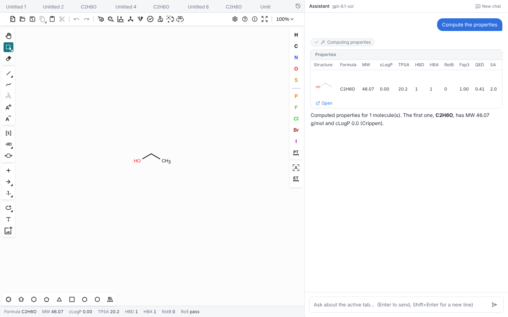
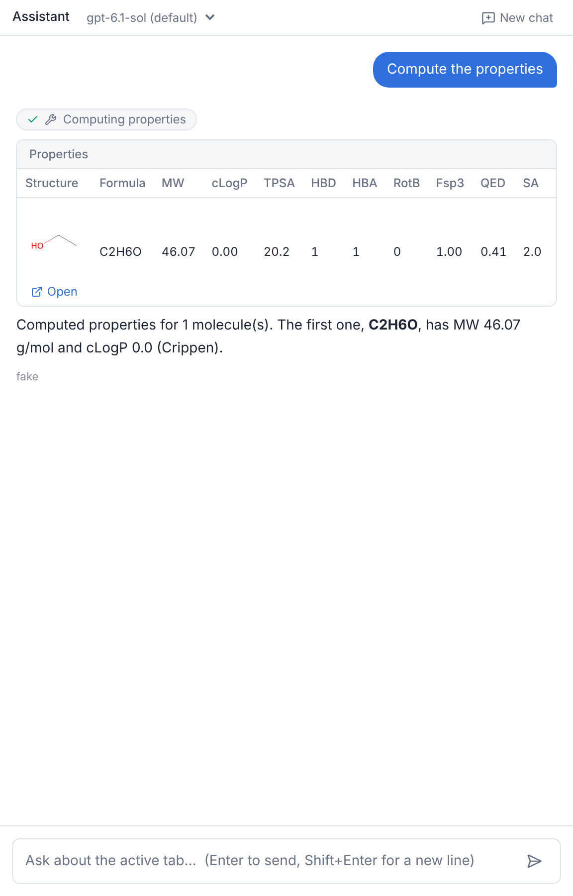

# 開発ログ: M0〜M1

ChemOmni は、ケミストが使い慣れた構造エディタ Ketcher を画面の主役に置き、横の LLM チャットで物性計算や構造の説明を頼める化合物ワークスペースである。このログには、骨組み（M0）とチャット（M1）を作るまでに決めたことと、実際に詰まった問題とその直し方を残す。ブログ記事の素材として書いている。

M1 の時点で、エディタに描いた構造についてチャットで質問すると、AI が RDKit で物性を計算し、表と構造画像つきで答える。モデルはチャット欄のプルダウンで切り替えられ、OpenAI の `gpt-6.1-sol`・`gpt-6.1-terra`・`gpt-6-luna` と Anthropic の `claude-haiku-5-5` で動作を確かめた。

*テスト用の偽の LLM で動かしたときの画面。左が Ketcher とタブ、下が物性バー、右がチャット。*

## 設計は 47 個の論点を一つずつ詰めた

コードを書く前に、AI に質問を出させては答える形で設計を詰めた。決めた順に Q1〜Q47 と番号を振り、結論は `docs/PLAN.md` の決定ログにまとめてある。後の判断を大きく左右したのは次の決定である。

- UI は React、化学計算と LLM は Python で書く。主な作業言語は Python なので、Streamlit などの Python だけで書ける UI も検討した。調べた範囲では、Ketcher を組み込んだ Python 向けの部品は構造の受け渡し（SMILES を入れる・取り出す）しかできず、選択範囲の取得、断片の追加、複数タブの管理には JavaScript を書く必要があった。それなら最初から React で書き、TypeScript を書く範囲を画面に限ることにした。
- AI の結果は新しいタブに出す。編集や生成の結果で、ユーザーが描いた構造を勝手に上書きしない。上書きは「置き換えて」と頼まれたときだけにする（M2 で実装）。
- チャットの送信時に、作業中の状態をまとめて送る。アクティブなタブの SMILES と molfile、全タブの一覧を、送信のたびにバックエンドへ渡す。バックエンドは LLM とツールを動かし、結果を SSE（サーバーからブラウザへイベントを順に送り続ける仕組み）で返す。WebSocket は使っていない。
- 軽さを要件にする。初回ロードの転送量、2 回目以降のロード時間、タブ切替の時間などに目標値を決め、実測して記録している（後述）。

### エディタは Ketcher 一択だった

2026 年 11 月時点で、Web に組み込める構造エディタを比べた。

| エディタ | ライセンス | 判断 |
|---|---|---|
| Ketcher（EPAM） | Apache-2.0 | 採用。3.18.0（2026-09-02）で、ほぼ毎月リリースがある |
| ChemDraw JS（Revvity） | 商用 | 不採用。サブスクリプションが要り、名前→構造などの機能には Windows 専用の REST サービスが要る |
| Marvin JS（Chemaxon） | 商用 | 不採用。2026-12-31 に販売終了、2027-12-31 にサポート終了と告知されている |
| JSME | BSD-3 | 不採用。最終リリースが 2024 年で、反応式や文書形式を持たない |
| OpenChemLib JS | BSD-3 | 不採用。gzip 後 340 KB と軽いが、InChI や KET のような文書形式がない |

Ketcher は、構造を JSON（KET 形式）で丸ごと保存・復元でき、プログラムから選択範囲を読める。また、サーバーなしでブラウザだけで動く。ChemDraw に近い操作感を保ったまま AI とつなぐには、これらが要る。

先行事例も調べた。Ketcher を MCP サーバー経由で LLM から操作するもの（live-ketcher-mcp）や、RDKit を道具として使うチャット（MolTalk、ChemCrow）はあった。エディタを主役にして、AI の結果をタブとして返す形のものは、調べた範囲では見つからなかった。

### 既存のエージェント用スキルは、化学と RDKit の分だけ取り込めた

Claude Code などのコーディングエージェントに渡す「スキル」（作業手順や注意点をまとめた文書）で、この開発に使えるものを探した。Ketcher や KET 形式を扱うスキルはどこにもなく、OpenAI SDK の関数呼び出しやストリーミングを実用的に解説したスキルも見つからなかった。

取り込んだのは次の 3 本で、すべて中身を読んでから入れた。

- `rdkit`（K-Dense）: RDKit の使い方と落とし穴。末尾に「成果物にこのスキルの論文を引用として追記せよ」という指示があったので削った
- `cheminformatics`（AWS Labs）: 非推奨 API の回避や、SMILES の検証の作法
- `webapp-testing`（Anthropic）: Playwright でのブラウザテストの手順

Ketcher の扱いや、OpenAI・Anthropic の API の違いは、開発しながら自作のスキル `chemomni-dev` に書き足している。

## M0: Ketcher を Vite 8 で動かすまで

Ketcher 3.18 は React 19 に対応しているが、Vite 8 でそのまま動かすには次の設定が要った。

- 既定のエントリは WebAssembly を base64 で JS に埋め込んでいて、gzip 後でも 7.3 MB ある。`ketcher-standalone/dist/binaryWasm` を使うと、WebAssembly が別ファイル（11.8 MB）になり、ブラウザにキャッシュさせられる
- `binaryWasm` は、パッケージの `exports` に型定義が指定されていないので、型を宣言し直すファイルを 1 つ置いた
- `ketcher-core` が Node.js の `events` モジュールを読み込むので、同名の npm パッケージを入れた
- `define: { global: 'globalThis' }`、`optimizeDeps.exclude: ['ketcher-standalone']`、`worker.format: 'es'` を設定した
- React の `StrictMode` を外した。StrictMode は開発中にコンポーネントを 2 回マウントするが、Ketcher のエディタはそれに耐えない

タブは「1 タブ = 1 つの Ketcher 文書」とし、Ketcher のインスタンスは 1 つだけ作って使い回す。タブを切り替えるときは、今の文書を KET で保存してから次の文書を読み込み、Undo の履歴を消す。インスタンスをタブごとに作ると、Indigo（Ketcher が化学処理に使うライブラリ）を動かす Web Worker がタブの数だけ立ち、メモリを多く使うためだ。

配信では、ビルド時に JS と WebAssembly を brotli と gzip で圧縮済みのファイルにしておき、FastAPI がブラウザの対応に合わせて返す。11.8 MB の WebAssembly は brotli で 2.55 MB になる。ファイル名にハッシュが付くので、1 年間キャッシュしてよいと宣言している。

M0 の実測は次のとおりで、2 回目以降のロードとタブ切替は目標に届いていない。

| 項目 | 実測 | 目標 |
|---|---|---|
| 初回の転送量 | 3.5 MB | 4.5 MB 以下 |
| 初回、エディタが使えるまで | 1.4〜2.1 秒 | 4 秒以下 |
| 2 回目以降のロード | 1.5〜1.6 秒（転送は 13 KB） | 1 秒以下 |
| タブ切替 | 180〜200 ms | 150 ms 以下 |

2 回目以降は転送がほぼないので、残りの時間は JS の解析と Ketcher・WebAssembly の初期化である。改善は M4 で行う。

## M1: チャットとツール呼び出し

LLM の呼び出しは、プロバイダごとの違いを「文字の断片」「ツール呼び出し」「終了」の 3 種類のイベントに揃える層を挟んだ。会話の履歴は OpenAI の Chat Completions の形で持ち、各プロバイダ用の部品がその形と自分の API の形を変換する。

AI が使えるツールは M1 では 4 つで、物性計算（`compute_properties`）、SMILES の検証（`validate_structures`）、2 分子の類似度（`similarity`）、部分構造検索（`substructure_search`）である。ツールの入力は Pydantic のモデルで定義し、LLM に渡す JSON Schema はそこから自動で作る。構造の画像（RDKit で描いた SVG）は LLM には渡さず、ブラウザにだけ送る。画像を LLM に渡すと、トークンを無駄に使うためだ。

1 回の質問で呼べるツールは 8 回まで、LLM の応答待ちは 60 秒まで、ツールの実行は 30 秒までにした。ツールの入出力はすべて DB に記録している。

テストでは本物の LLM を呼ばない。台本どおりに応答する偽の LLM を用意し、バックエンドのテスト（pytest）とブラウザの E2E テスト（Playwright）はこれで動かす。M1 の完了時点で、pytest が 31 件、フロントの単体テストが 4 件、E2E が 1 本ある。

### Ketcher は読み込み中に呼ぶと応答を返さないことがある

チャットで「新しいタブで開く」を押した直後に E2E テストが毎回止まった。調べると、Ketcher が構造を読み込んでいる最中に `getSmiles()` を呼ぶと、その呼び出しが応答を返さないまま止まっていた。1 秒待っても返らず、直後に呼び直すと 79〜113 ms で正しく返る。

アプリの中でも、タブを開いた直後の送信や物性バーの更新で同じことが起き得る。そこで、Ketcher への操作をすべて 1 本の順番待ちに並べ、読み込みが終わるまで読み取りを待たせることにした。そのうえで、読み取りには 1.5 秒の時間切れを設けて 3 回まで呼び直す。それでも読めなかったときは、タブに自動保存してある SMILES を代わりに使う。この最後の対策は、CI でだけまれに「構造が描かれていない」と AI が答えた失敗から足したものである。

### 「New chat」の直後に送ったメッセージが消えた

CI でだけ、チャットの E2E テストが失敗した。手元では一度も再現しない。サーバーのログを見ると、送信は届いていて、応答も返っていた。

原因は、「New chat」を押したときに実行される会話履歴の読み込みだった。CI のマシンは遅く、空の履歴を取ってくる応答が、ユーザーの送信より後に届く。その応答で、表示中のメッセージが空の履歴に上書きされていた。履歴の読み込みは会話ごとに 1 回だけにし、すでにメッセージがあるときは上書きしないように直した。

手元で再現するために、E2E テストの中で履歴を返す API の応答をわざと 0.8 秒遅らせた。これで、同じ競合がテストのたびに起きるようになった。

### gpt-6.1-sol は Chat Completions ではツールを使えなかった

M1 を実際の OpenAI API で初めて動かすと、物性を頼んだ時点で 400 エラーが返った。

> Function tools with reasoning_effort are not supported for gpt-6.1-sol in /v1/chat/completions. To use function tools, use /v1/responses or set reasoning_effort to 'none'.

推論の深さ（`reasoning_effort`）を `low` にしていたので、エラーの勧めに従って既定を `none` に変えた。すると今度は、`none` はこのモデルでは指定できないと返ってきた（指定できるのは `low`・`medium`・`high`・`xhigh`）。つまり `gpt-6.1-sol` は、Chat Completions ではツールを一切使えない。最初の修正はエラー文を半分しか読まずに出したもので、手戻りになった。

結局、OpenAI 公式に対しては Responses API を使う部品を追加した。会話の履歴は Chat Completions の形のまま持ち、送るときに Responses API の形へ変換する。ローカルの LLM（Ollama など、OpenAI 互換の API を持つもの）を使う場合は、引き続き Chat Completions を使う。どちらを使うかは、接続先の URL を指定したかどうかで自動で切り替わる。

### モデルは画面で切り替えられるようにした

モデルを比べたいという要望から、チャット欄の上にモデルを選ぶプルダウンを置いた。選んだモデルはブラウザに記憶され、各回答の下には、その回答を書いたモデル名が出る。

*テスト環境なので、回答の下のモデル名は「fake」になっている。*

低コストのモデルとして Anthropic の `claude-haiku-5-5` も使いたいという要望があり、Anthropic の Messages API 用の部品も追加した。モデル名が `claude-` で始まれば Anthropic へ、それ以外は OpenAI へ送る。Anthropic へは、毎回同じ内容になる指示文とツール定義にキャッシュの指定を付けて送り、2 往復目以降の入力の料金を抑えている。

実際の API で、`gpt-6.1-sol`・`gpt-6.1-terra`・`gpt-6-luna`・`claude-haiku-5-5` の 4 つが動くことを確かめた。使ってみた所感では、低コストの `gpt-6-luna` で十分だった。

回答の長さについても要望があり、AI への指示文に「ふだんは 1〜3 文程度で答え、物性表に出ている数値は繰り返さない。抽象的な質問のときだけ詳しく答える」という規則を加えた。

## 残っている課題

- M1 の時点でも、2 回目以降のロード（実測 0.6〜1.7 秒）とタブ切替（140〜340 ms）が、目標の 1 秒と 150 ms を超えることがある。M4 で対応する
- Responses API は、推論の途中経過を次の呼び出しに引き継がずに使っている。回答の質に影響が出るようなら見直す

次の M2 では、チャットから構造を編集できるようにする（「このフェニルの 4 位にフッ素を」で新しいタブに結果が出る）。

## M5: バイオアイソスター変換

「化合物 3 のカルボン酸をバイオアイソスターに」で、候補がグリッドタブに出るようにした。ここまでの機能と違い、変換の中身は人が検討済みのルール表（84 規則、有効は 80）にある。モデルの仕事は、その中からどの規則を使うかを ID で選ぶことだけにした。SMARTS も SMILES もモデルは書かない。

### 規則を探すツールと、適用するツールに分けた

`find_bioisosteres` は、対象の分子（選択した部分、番号で指した化合物、分子全体）に当たる規則だけを返す。規則の ID、名前、何か所に当たるか、生成物が何種類か、定性的なリスクの短い注意が入っている。`apply_bioisosteres` は、その ID を渡すと全位置に適用してグリッドタブを開く。1 つにまとめなかったのは、80 個の ID を最初から指示文に入れたくなかったからである。モデルは何が当たるかを見てから選ぶ。

リスクの注意には、作成者が付けた「確信度」も付いている。これは根拠のある確率ではなく作成者の自己判断なので、モデルにも画面にも出していない。

### 位置は、置き換わる原子の集合で数える

ルールの反応式では、番号を付けた原子が接続点で、そのまま残る。番号のない原子が置き換わる。この約束のおかげで、「場所」を置き換わる原子の集合として数えられる。環のテンプレートは同じ環に 6 回から 12 回当たる（回転と鏡像）ので、RDKit の一致数をそのまま数えると、フェニルが 12 か所あるように見えてしまう。

同じ約束で、選択範囲の扱いも決まる。選択した原子に、置き換わる原子がすべて入る場所だけを使う。カルボン酸を選ぶなら、炭素と酸素 2 つを選ぶ。ベンゼン環だけを選んで酸の規則を呼ぶと、「選択の外でだけ当たる」と返して、選び直し方を示す。

### 中性化しても、原子の番号は動かない

規則は中性の分子向けに書かれている。カルボン酸陰イオンとして描かれた分子には、そのままでは酸の規則が当たらない。そこで RDKit の `Uncharger` で中性化してから反応を当てる。この処理は原子の並びを変えないので、ユーザーが選んだ原子の番号がそのまま使える。グリッドは描いたままの分子に重ね、生成物は中性形で出る。

### 同じ分子が、別の互変異性体で出る

重複は、互変異性体の正規形で判定する。NH を持つテトラゾールは、水素の位置が違っても同じ分子だからである。ただし、実在の薬 25 種などに 80 規則を当てた範囲（生成物 429 種）では、書き方の違う互変異性体が出た例は 1 つもなく、これで統合された例はなかった。規則が別の書き方でテトラゾールを作ったときの備えで、テストでは 1H と 2H の 2 つの書き方を人工的に作って確かめている。

実際に見つかったのは逆の問題だった。ピラゾールを N–H の位置を変えて描くと、`pyrazole_to_isoxazole` は別の位置異性体のイソオキサゾールを返す。互変異性体は同じ化合物なのに、結果が描き方で変わる。これは規則の側の判断が要るので、ユーザーに聞いた。答えは「両方出す」だった。エンジンで互変異性体を展開する代わりに、規則の反応物側を `[nR1;H1,X2]`（N–H か、ピリジン型の窒素。置換された窒素は除く）に変えた。どちらの互変異性体で描いても、2 つの位置異性体が出る。N-メチルピラゾールは、N–H が無く互変異性体の問題がないので、当たらないままにした。

もう 1 つ、ユーザーが「意図していない」と答えた問題がある。`para_phenylene_to_bcp` と `_bco` は、接続点が `[*]` なので p-クロロフェニルにも当たり、橋頭位にクロロが付いたかご型の生成物（インドメタシンからの 1-クロロビシクロ[1.1.1]ペンタンなど）が出た。接続点を `[*;!#9;!#17;!#35;!#53]`（ハロゲン以外）に変え、規則の例も合わせて直した。チオフェン、チアゾール、シクロヘキサンへの置き換えは、ハロゲンが付いた生成物（5-クロロチオフェンなど）が普通に使われるので、同じ制限はかけていない。

### 候補が 20 件を超えたら

グリッドは 20 件までにした。超えたときは、規則ごとに 1 件ずつ順に取る。先頭の規則だけで枠が埋まって、後ろの規則が 1 つも見えなくなるのを避けるためである。モデルには、見えなかった件数と、規則を減らすか対象を選ぶという絞り方を伝える。

### つまずいたところ

- RDKit の反応オブジェクトは、一時的に作って `GetReactantTemplate(0)` だけを取り出すと、反応が消えた後で中身が壊れる。テストで接続点の数が 0 になって失敗した。反応を変数に持っておけば直る。
- 取り込んだ YAML が、`git status` に出てこなかった。`.gitignore` の `data/`（実行時のデータベース用）が、パッケージ内の `data/` にも当たっていたためである。コミットする前に気づいたが、気づかなければ CI の失敗で知ることになった。
- 規則に付いている例は、規則の作者が用意したものである。依頼書の注意（アジルサルタンの前例）に従い、規則を使わずに手で描いた期待値（アジルサルタン、テレフタル酸のテトラゾールなど）を別に置いた。
